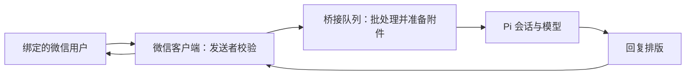

# 架构说明

## 仓库结构

```text
index.ts                       Pi 扩展入口（也是 npm 包入口）
src/
  extension/                   Pi 生命周期、命令与 UI；runtime.ts 承载 BridgeRuntime
  bridge/                      状态、归属与消息队列
  wechat/                      iLink API、客户端、媒体与协议类型
  messaging/                   回复排版、来源标记与回复模板
  shared/                      常量、日志与通用工具
tests/
  bridge/                      桥接模块测试
  extension/                   命令与状态测试
  integration/                 扩展生命周期与同步测试
  messaging/                   排版与模板测试
  shared/ wechat/              工具函数与客户端测试
  e2e/                         近真机端到端：Fake iLink/CDN + Fake LLM + 真实 Pi SDK，含双进程交接
prompts/                       随包发布的默认回复模板
docs/                          用户文档（英/中双语）与开发文档（中文）
scripts/                       兼容性与打包检查
assets/                        Logo 与封面
.github/                       CI、发布流程与模板
```

Pi 基线为 [`@earendil-works/pi-coding-agent >= 1.2.0`](https://github.com/earendil-works/pi)（peerDependency）；开发环境安装 1.6.x，Pi 直接加载 TypeScript 入口，无需构建产物。

## 模块职责

| 模块 | 职责 |
| --- | --- |
| `extension/index.ts` | 注册 Pi 命令、事件与桥接工具，协调扩展生命周期 |
| `extension/runtime.ts` | `BridgeRuntime`：桥接全部可变状态与生命周期（启动、停止、交接、轮询、发送） |
| `extension/commands.ts`、`remote-commands.ts` | 桥接生命周期命令与微信远程命令 |
| `extension/config-commands.ts`、`config-menu.ts` | 配置命令与对话框，含任务空闲协调 |
| `extension/command-completion.ts` | `/wechat` 子命令与参数补全 |
| `extension/send-tools.ts` | 发送工具注册、文件守卫与运行状态检查 |
| `extension/model-failure.ts`、`status.ts`、`completion-summary.ts`、`new-session.ts` | 模型错误通知、状态展示、完成摘要与 `/new` 会话切换 |
| `bridge/config.ts`、`config-values.ts` | 配置缓存与持久化；`resolveConfig()` 提供归一化后的生效配置 |
| `bridge/transport-state.ts` | 游标、已见消息 ID 与上下文令牌的序列化/节流持久化 |
| `bridge/state-storage.ts` | 状态目录与 JSON 文件读写；目录按 `HOME`/`USERPROFILE` 每次动态解析，便于测试隔离 |
| `bridge/bridge-lock.ts`、`bridge-ownership.ts` | 归属检查、锁获取/释放与协作交接 |
| `bridge/queue.ts` | 入站消息批处理、附件准备与 Pi 提交 |
| `bridge/outbox.ts` | 按账号隔离的被拒文本暂存、串行补发与分块进度；歧义投递进入挂起 |
| `wechat/api.ts`、`client.ts` | iLink 请求、轮询、发送与消息发送凭证 |
| `wechat/media.ts`、`security.ts`、`types.ts` | 媒体处理、绑定发送者校验与协议类型 |
| `messaging/` | 出站文本排版、来源标记与回复规则加载 |
| `shared/` | 不依赖其他领域的通用工具 |

运行时消费方直接从 `bridge/config.ts` 导入配置，微信客户端通过 `bridge/transport-state.ts` 持久化传输状态而不依赖登录代码；发送工具读取实时客户端/运行状态并在异步守卫后复查。

## 运行流程



1. 入口加载 `src/extension/index.ts`，注册命令、事件与桥接工具。
2. 启动桥接时加载本地状态并获取归属锁；微信客户端轮询 iLink，校验绑定发送者后把消息送入队列。
3. 队列批处理消息并准备附件，再提交给 Pi；`resolveConfig()` 在每次使用时读取生效配置，messaging 模块提供来源标记与回复规则。
4. Pi 事件驱动回复投递：`agent_before_settle` / `agent_settled` 驱动模型错误通知与完成摘要，排版后由微信客户端送达。
5. AI 文本或错误通知被拒（`ret=-2`）时，outbox 原子保存未送达分块；绑定用户下一条消息触发有界补发，歧义投递不会被盲目重试。
6. 停止/交接等待轮询、发送与 outbox 写入完成后才释放锁，前后持有者不会互相覆盖记录。

## 包与本地状态

`package.json` 的 `files` 白名单发布运行时源码、prompts、docs 与 assets；`npm run check:package` 校验实际发布文件列表。移动模板加载器时需保持其相对 `import.meta.url` 的路径。

账号状态位于 `~/.pi/agent/wechat-assistant/`（随 `HOME`/`USERPROFILE` 动态解析）；接收文件保存在当前项目的 `.pi-wechat-files/`。这些是运行时数据，不属于仓库；测试使用隔离的状态目录。

开发命令见[贡献指南](https://github.com/shenjiecode/pi-wechat-assistant/blob/main/docs/CONTRIBUTING.md)，日志与发版检查见[维护指南](https://github.com/shenjiecode/pi-wechat-assistant/blob/main/docs/maintenance.md)。

## 领域边界

`npm run check:architecture` 解析 TypeScript 导入/再导出与字面量动态导入，禁止反向领域依赖、运行时循环、缺失的相对目标和非 `.js` 相对导入。它包含在 `npm run check` 中。

- `extension` 协调其他领域，下层不得导入它。
- `bridge` 协调状态、队列、排版与传输。
- `wechat` 负责协议与媒体；仅 `client.ts` 可使用 `bridge/transport-state.ts` 持久化。
- `messaging` 负责排版与模板；仅模板加载器可使用 `bridge/state-storage.ts` 定位目录。
- `shared` 不导入任何其他领域。

两处持久化依赖是显式例外，而非允许下层导入整个 bridge 的许可；类型层面的边界同样检查，但不参与运行时循环检测。`extension/runtime.ts`（`BridgeRuntime`）集中管理生命周期、轮询与发送状态，`extension/index.ts` 仅保留 Pi 事件与命令接线；新模块应在职责清晰且有行为测试时再拆分。
