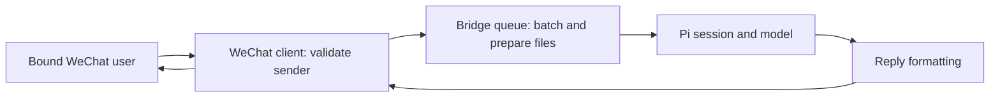

# Architecture

English | [简体中文](https://github.com/shenjiecode/pi-wechat-assistant/blob/main/docs/architecture.zh.md)

## Repository layout

```text
index.ts                       Public Pi extension entry
src/
  extension/                   Pi lifecycle, commands and UI
  bridge/                      State, ownership and message queue
  wechat/                      iLink API, client, media and types
  messaging/                   Reply formatting, source and prompts
  shared/                      Constants, logging and helpers
tests/
  bridge/                      Bridge module tests
  extension/                   Command and status tests
  integration/                 Extension lifecycle and sync tests
  messaging/                   Formatting and prompt tests
  shared/                      Helper tests
  wechat/                      Client and sender validation tests
prompts/                       Packaged default reply template
docs/                          User and developer documentation
scripts/                       Compatibility and package checks
assets/                        Logo and package cover
.github/                       CI, release workflow and templates
```

## Module responsibilities

| Module | Responsibility |
| --- | --- |
| `extension/index.ts` | Register Pi events and tools; coordinate bridge lifecycle and turn state |
| `extension/commands.ts`, `remote-commands.ts` | Bridge lifecycle commands and WeChat commands |
| `extension/config-commands.ts`, `config-menu.ts` | Configuration/template commands and dialogs, including task-idle coordination |
| `extension/send-tools.ts` | Sending-tool registration, file guards and live bridge-state checks |
| `extension/model-failure.ts`, `status.ts` | Pi failure compatibility and status presentation |
| `bridge/auth.ts` | Login credentials and ownership entry points; compatibility re-exports |
| `bridge/config.ts`, `config-values.ts` | Configuration cache/persistence, receipt defaults, image resolution and numeric command validation |
| `bridge/transport-state.ts` | Cursor, seen-message IDs and serialized/throttled context-token persistence |
| `bridge/state-storage.ts` | Shared state directory and JSON file permissions/read/write helpers |
| `bridge/bridge-lock.ts`, `bridge-ownership.ts` | Inspect ownership, acquire and release locks, coordinate handoff |
| `bridge/queue.ts` | Batch incoming messages, prepare attachments and submit Pi requests |
| `wechat/api.ts`, `client.ts` | iLink requests, polling, sending and message-send credentials |
| `wechat/media.ts`, `security.ts`, `types.ts` | Media handling, bound-sender checks and protocol types |
| `messaging/` | Format outgoing text, mark message sources and load reply rules |
| `shared/` | Small shared helpers without importing domain modules |

The WeChat client persists transport state through `bridge/transport-state.ts`, without depending on login/configuration code. Runtime consumers import configuration directly from `bridge/config.ts`; legacy exports in `auth.ts` refer to the same cache. Configuration commands use a narrow dependency interface, while lifecycle coordination remains in the extension entry. Sending tools read live client/running state and recheck it after asynchronous guards.

Configuration retains the existing JSON path, keys, unknown fields, per-process cache, and save-after-write behavior. Reading never writes defaults or migrations. Explicit `false` and zero values are preserved; image JSON values take precedence over environment fallbacks. The existing queue image-setting exports remain compatibility wrappers. Configuration tests use isolated state directories and cover reloads, failed saves, defaults, validation, and transport-state isolation.

## Runtime flow



1. The root entry loads `src/extension/index.ts`, which registers Pi commands, events and bridge tools.

2. Starting the bridge loads local state and acquires ownership. The WeChat client polls iLink and checks the bound sender before messages reach the queue.

3. The queue batches messages and prepares attachments before submitting them to Pi. Messaging modules provide the source marker and reply rules.

4. Pi events drive reply delivery through the formatter and WeChat client. Desktop input mirroring follows the bidirectional setting, which is off by default.

5. Stopping or handing off drains bridge work and releases ownership. Cross-session handoff has dedicated filesystem tests; integration tests cover the extension's event behavior.

## Package and local state

`package.json` keeps `index.ts` as both the package entry and Pi extension entry. Pi loads TypeScript directly, and the npm `files` allowlist ships runtime source, prompts, docs and assets. `npm run check:package` checks the actual npm file list, including every source file and the default reply template. Moving the prompt loader requires preserving its URL relative to `import.meta.url`.

Account state lives in `~/.pi/agent/wechat-assistant/`; received files live in the active project's `.pi-wechat-files/`. These are runtime data, not repository assets. Tests use mocks or scratch directories under `node_modules/.cache/`.

For development commands and release checks, see [Contributing](https://github.com/shenjiecode/pi-wechat-assistant/blob/main/docs/CONTRIBUTING.md).

## Keep dependencies understandable

`npm run check:architecture` parses TypeScript imports/re-exports and literal dynamic imports. It rejects reverse domain dependencies, runtime cycles, missing relative targets, non-`.js` relative imports and runtime Pi-host imports. It runs inside `npm run check`.

- `extension` coordinates the other domains. Lower layers do not import it.
- `bridge` coordinates state, queueing, messaging and transport.
- `wechat` owns protocol handling and media; only `client.ts` may use `bridge/transport-state.ts` for persistence.
- `messaging` owns formatting and templates; only the prompt loader may use `bridge/state-storage.ts` for its directory. It no longer imports the login/ownership facade just to find a path.
- `shared` imports no other domain.

The two persistence edges are explicit exceptions, not permission for lower layers to import the whole bridge. Type-only edges are checked for domain boundaries but excluded from runtime-cycle detection. Computed dynamic imports and CommonJS `require` are outside this guard's scope; use the project's static ESM conventions.

The lifecycle coordinator in `extension/index.ts` and batching queue remain together because their cancellation, send/drain and ownership state interact. Extract a module when it has a clear responsibility and behavioral tests, rather than splitting only to reduce line count. See [maintenance](https://github.com/shenjiecode/pi-wechat-assistant/blob/main/docs/maintenance.md) for logging constraints and verification boundaries.
